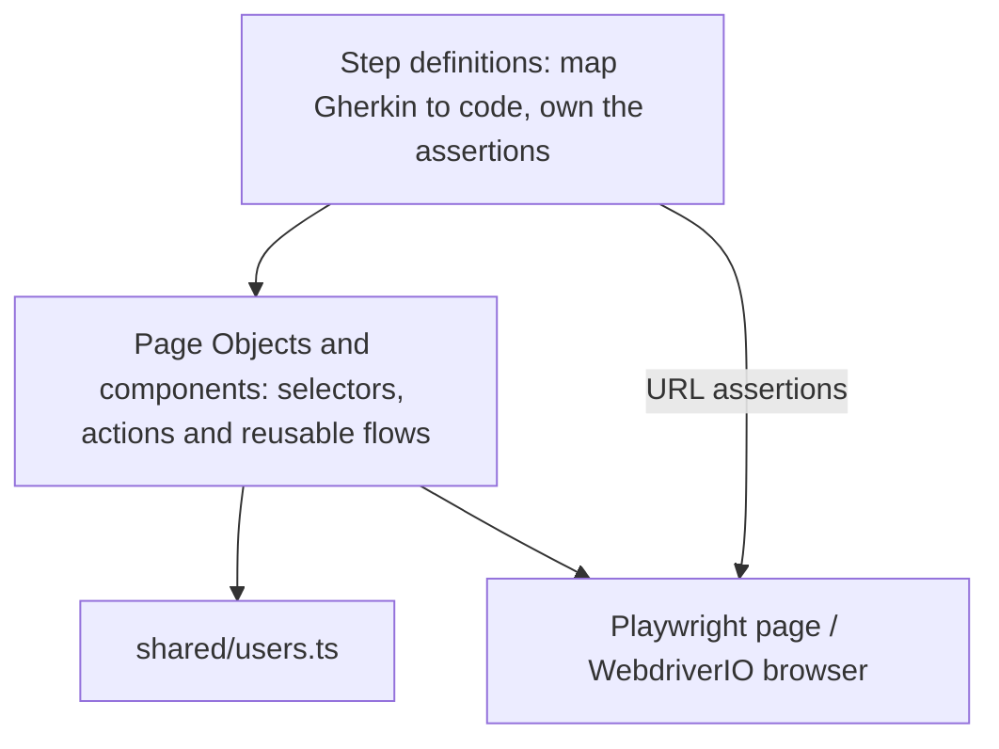

# SauceDemo Login: BDD with Playwright and WebdriverIO

Automated login tests for [SauceDemo](https://www.saucedemo.com/), written in Gherkin and executed by **two runners on the same feature file**:

- **WebdriverIO + Cucumber**.
- **Playwright + [playwright-bdd](https://vitalets.github.io/playwright-bdd/)**.

## Why two frameworks

The challenge prefers WebdriverIO with Cucumber, and Playwright with BDD is also of interest. Instead of choosing one, this repo treats the `.feature` file as the single source of truth and implements the same step contract in both frameworks:

- The scenarios describe behavior; the framework is an implementation detail.
- Both runners must agree on the result, which makes the suite easy to compare (setup, speed, debugging, ergonomics).
- Each framework lives in its own npm workspace, so dependencies and global types never collide.

## Tech stack

| Area         | Choice                                                                  |
| ------------ | ----------------------------------------------------------------------- |
| Language     | TypeScript 5.9                                                          |
| Playwright   | `@playwright/test` 1.64 + `playwright-bdd` 9.2                          |
| WebdriverIO  | WebdriverIO 9.32 + `@wdio/cucumber-framework` (Cucumber)                |
| WDIO UI      | `@wdio/devtools-service` 10.11                                          |
| Code quality | ESLint 9 (`typescript-eslint`, `eslint-plugin-playwright`) + Prettier 3 |
| Monorepo     | npm workspaces                                                          |

WebdriverIO 9 was chosen over 10 because WebdriverIO 10 requires Node 22.19 or later, while 9 runs on Node 20, so the suite works on more reviewer machines. For the same reason the DevTools service stays on 10.x: 11.x requires Node 22.19, while 10.x works on any Node 22.

## Project structure

```
.vscode/                 # Cucumber extension: links the feature file to both step folders
features/
  login.feature          # Shared Gherkin scenarios (single source of truth)
shared/
  env.ts                 # Loads the root .env (BASE_URL, SAUCE_PASSWORD, HEADLESS)
  users.ts               # Known SauceDemo users and passwordFor(username)
playwright/
  playwright.config.ts   # playwright-bdd config and reporters
  fixtures.ts            # Page fixtures, createBdd(test)
  .features-gen/         # Specs generated by bddgen from the feature file (not committed)
  pages/                 # BasePage, LoginPage, InventoryPage
  components/SideMenu.ts
  steps/login.steps.ts
wdio/
  wdio.conf.ts           # Cucumber framework, reporters, hooks, DevTools service
  pages/                 # Page, LoginPage, InventoryPage
  components/SideMenu.ts
  steps/login.steps.ts
```

## Architecture

Both frameworks follow the same layers. Each layer only depends on the layers below it.



- **Page Objects** hold `data-test` selectors and actions (`open`, `fillUsername`, `submit`, `login`). They contain no assertions.
- **Components**: `SideMenu` is shared by every logged-in page and is composed into `InventoryPage`.
- **Reusable flows** are page object methods that wrap multi-step actions:
  - `LoginPage.loginAs(username)` resolves the password from `shared/users.ts` and logs in.
  - `SideMenu.logout()` opens the side menu and clicks Logout.
- **Steps** are thin and contain no selectors. Assertions live in the `Then` steps; URL checks use the driver directly (`page` in Playwright, `browser` in WebdriverIO).

### Page objects in each framework

| WebdriverIO                                                                 | Playwright                                                                |
| --------------------------------------------------------------------------- | ------------------------------------------------------------------------- |
| Each page object is exported as a single instance and imported by the steps | Page objects are created per test as fixtures and injected into the steps |
| `await LoginPage.loginAs('standard_user')`                                  | `async ({ loginPage }) => loginPage.loginAs('standard_user')`             |

## Scenarios

All scenarios start from the login page (`Background`) and inherit the feature tag `@login`.

| Scenario                                                                                                      | Tags        |
| ------------------------------------------------------------------------------------------------------------- | ----------- |
| Successful login with valid credentials                                                                       | `@smoke`    |
| Login fails with a wrong password, an unknown user, an empty username or an empty password (Scenario Outline) | `@negative` |
| Locked out user cannot log in                                                                                 | `@negative` |
| Logout returns to the login page                                                                              | `@smoke`    |

## Getting started

### 1. Install the prerequisites

- **Node.js 22 LTS** (npm is included). Node 20.18 also runs the suite, except `npm run test:wdio:ui`, because the DevTools server depends on packages that require Node 22. Install it from [nodejs.org](https://nodejs.org/) or with [nvm](https://github.com/nvm-sh/nvm):

  ```bash
  nvm install 22
  node -v   # v22.x
  ```

- **Git**, to clone the repository.
- **Google Chrome** (recommended). WebdriverIO uses the installed Chrome and downloads the matching ChromeDriver. Without Chrome, it downloads Chrome for Testing on the first run.

### 2. Install the project

```bash
git clone <repository-url>
cd <repository-folder>
npm install                      # Root and both workspaces (playwright, wdio)
npx playwright install chromium  # Chromium build used by Playwright
```

On Linux, use `npx playwright install --with-deps chromium` to also install the system libraries Chromium needs.

### 3. Configure the environment

```bash
cp .env.example .env
```

`.env.example` already contains SauceDemo's public password, so the copy works as is.

`.env` variables:

| Variable         | Default                     | Description                             |
| ---------------- | --------------------------- | --------------------------------------- |
| `BASE_URL`       | `https://www.saucedemo.com` | Application under test                  |
| `SAUCE_PASSWORD` | none, required              | Password shared by every SauceDemo user |
| `HEADLESS`       | `true`                      | Set to `false` to watch the browser     |

### 4. Check the setup

```bash
npm test
```

Playwright should report `7 passed` and WebdriverIO `Spec Files: 1 passed`. The first WebdriverIO run downloads ChromeDriver, so it takes longer.

On Windows, npm runs scripts with `cmd.exe`, which does not support the `HEADLESS=false ...` syntax used by `test:wdio:headed` and `test:wdio:ui`. Run them from WSL.

### 5. Editor (optional)

In VS Code, install the recommended Cucumber extension (`.vscode/extensions.json`) to jump from each Gherkin step to its definition in either framework.

## Running the tests

```bash
npm test                   # Playwright, then WebdriverIO
npm run test:pw:headless   # Playwright only
npm run test:wdio:headless # WebdriverIO only

npm run test:pw:headed     # Playwright with a visible browser
npm run test:wdio:headed   # WebdriverIO with a visible browser

npm run test:pw:debug      # Playwright Inspector: step through every action
npm run test:wdio:ui       # WebdriverIO with a visible browser plus DevTools: every step, command, console and network request

npm run test:headless -w playwright -- --grep @smoke           # Filter by tag (Playwright)
npm run test:headless -w wdio -- --cucumberOpts.tags='@smoke'  # Filter by tag (WebdriverIO)
```

`test:wdio:ui` runs the tests in a visible browser and opens the DevTools app in its own Chrome window, which keeps running after the tests so you can inspect each step or rerun a scenario. Close that window to finish. The page preview does not follow the run live: click a row in the Actions list to rebuild the page as it was after that command. The terminal is noisy in this mode because the DevTools server and its window log every request; the useful information is in the window.

Code quality:

```bash
npm run lint           # ESLint (npm run lint:fix to fix what it can)
npm run format:check   # Prettier (npm run format to rewrite the files)
npm run typecheck      # tsc on shared/ and both workspaces
```

## Reports

| Report                                              | Path                                                                                       |
| --------------------------------------------------- | ------------------------------------------------------------------------------------------ |
| Playwright, Cucumber HTML                           | `reports/playwright/cucumber-report.html`                                                  |
| Playwright HTML (traces and screenshots on failure) | `reports/playwright/html` (open with `npx playwright show-report reports/playwright/html`) |
| WebdriverIO, Cucumber HTML                          | `reports/wdio/cucumber-report.html`                                                        |

Both Cucumber reports use the official Cucumber HTML formatter, so the results of the two runners can be compared side by side.

## Design decisions

- **Shared features, isolated workspaces.** `playwright-bdd` and `@wdio/cucumber-framework` depend on different versions of `@cucumber/gherkin` and `@cucumber/messages`, and both frameworks declare a global `expect`. One workspace and one `tsconfig.json` per framework avoids both conflicts.
- **Stable selectors.** SauceDemo exposes `data-test` attributes. Playwright is configured with `testIdAttribute: 'data-test'` so it can use `getByTestId`. The menu button has no `data-test`, so it is found by its accessible name in both frameworks.
- **No credentials in code.** The password comes from `SAUCE_PASSWORD`. `passwordFor` fails fast with a clear message for unknown users or a missing variable. Negative scenarios use fake passwords, so the real one never appears in the feature file.
- **Test isolation.** Playwright creates a new browser context per test. WebdriverIO shares one session across the scenarios of a feature file, so the `afterScenario` hook clears cookies and `localStorage`.
- **Scenario Outline for negative cases.** One scenario covers every invalid input without duplicating steps.

## Playwright vs WebdriverIO

Observations from running this suite locally (7 scenarios, headless Chrome and Chromium):

|               | Playwright                                                                     | WebdriverIO                                                                                   |
| ------------- | ------------------------------------------------------------------------------ | --------------------------------------------------------------------------------------------- |
| Duration      | About 4 s (4 workers, the default on an 8-core machine, parallel per scenario) | About 4 s (1 worker, parallel per feature file)                                               |
| Waiting       | Waits until the element is visible, stable and enabled                         | Waits for the element to exist, plus an explicit `waitForClickable` for the sliding side menu |
| Page objects  | Fixtures created per test                                                      | Single instances imported by the steps                                                        |
| Debugging     | Traces, screenshots, Inspector                                                 | DevTools UI, spec reporter output and logs                                                    |
| Browser setup | Downloads its own Chromium with `npx playwright install`                       | Uses the installed Chrome (or downloads Chrome for Testing) and downloads the driver          |

### Which one fits this case better

Technically, Playwright is the better fit for a web-only suite on desktop browsers that is expected to grow:

- **Smarter waits.** It checks that an element is visible, stable and enabled before acting. WebdriverIO only waits for it to exist, which is why the side menu needs `waitForClickable`.
- **Isolation by design.** Each scenario gets a new browser context in milliseconds. WebdriverIO shares the session and relies on the `afterScenario` cleanup, which does not cover `sessionStorage` or IndexedDB.
- **Parallel per scenario.** Contexts are cheap, so scenarios are split across workers. WebdriverIO only parallelizes per feature file.
- **Post-mortem debugging.** Traces keep the DOM, network and console of every action and open straight from a CI failure. The WebdriverIO DevTools UI is less mature.
- **Reproducible setup.** One package with pinned browser builds that runs on Node 20. WebdriverIO depends on the installed Chrome, spans many packages, and its next major version needs Node 22.19.

The trade-off is BDD: `playwright-bdd` generates Playwright tests from the feature file instead of running the official Cucumber runtime. WebdriverIO becomes the better choice for native mobile apps (Appium), real Safari or devices on WebDriver grids, or when the full Cucumber runtime is a requirement.

## Known limitations and next steps

- Successful login is only covered for `standard_user`. Turning that scenario into a Scenario Outline with one row per user that can log in (`standard_user`, `problem_user`, `performance_glitch_user`, `error_user`, `visual_user`) would check every valid account without new steps. `performance_glitch_user` is deliberately slow to log in, so its assertions may need a longer timeout.
- `npm audit` reports vulnerabilities in transitive dependencies of WebdriverIO 9 (for example `@puppeteer/browsers`, `proxy-agent`, `extract-zip` and `tmp`). They are development-only tools and are not shipped. Upgrading to WebdriverIO 10 on Node 22.19 or later is the natural next step.
- The WebdriverIO Cucumber HTML report is written by each worker to the same file. With more feature files running in parallel, it should switch to one `message` file per worker merged at the end.
- Only Chrome and Chromium are covered. Firefox and WebKit can be added as extra Playwright projects and WebdriverIO capabilities.
- CI is not included. A GitHub Actions workflow with one job per framework would be the next addition.
